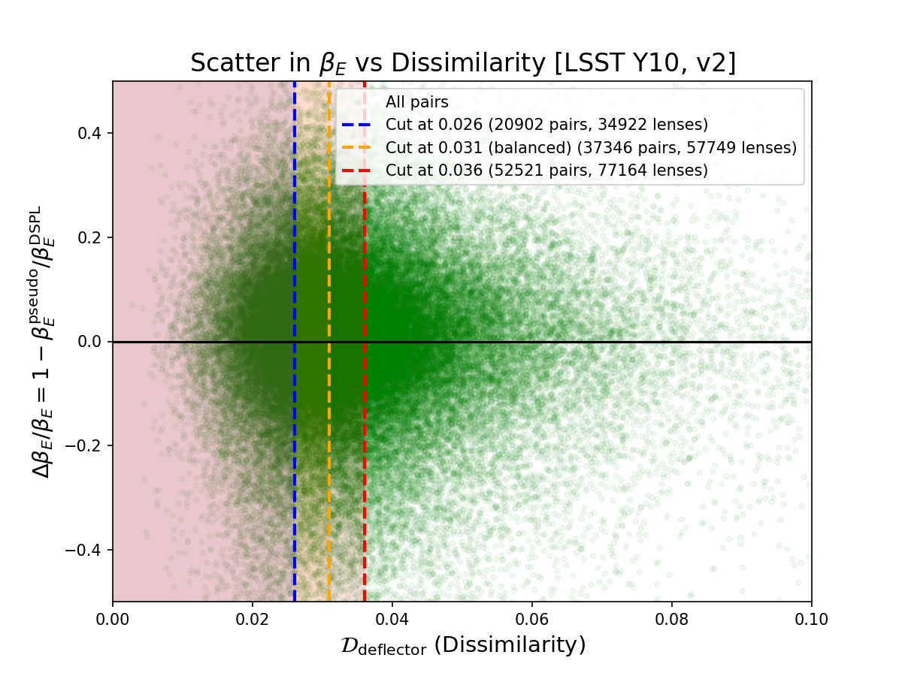
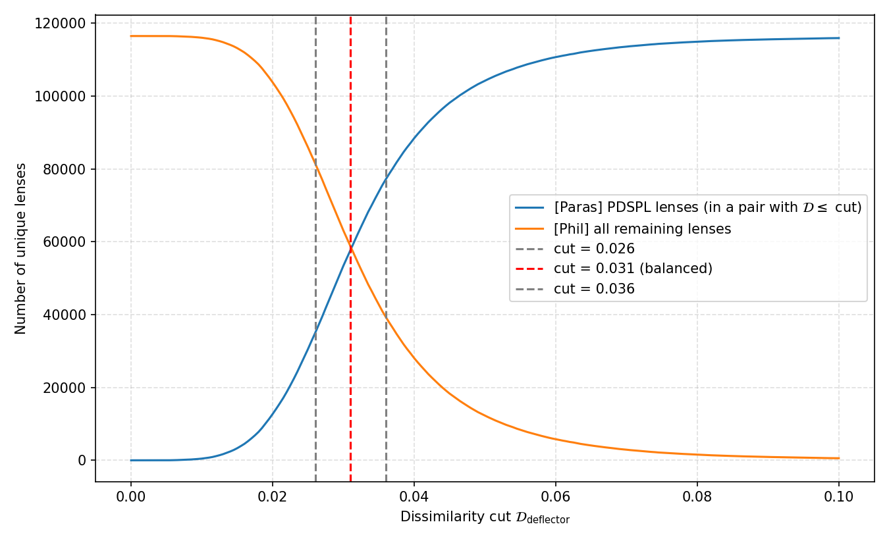
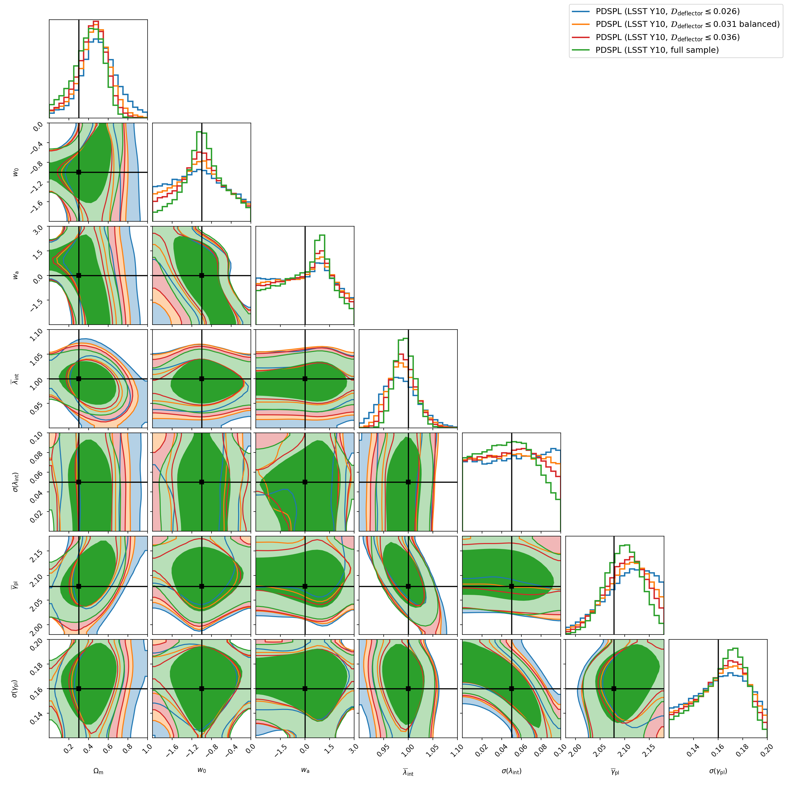

# PDSPL posteriors for the joint-DESC lens split (v2, Nov 2026)

These are w0waCDM forecasts for the PDSPL half of the LSST Y10 lens sample, split by deflector dissimilarity. The lenses not used here go to the complementary (non-PDSPL) analysis.

This replaces [`../posteriors_split_selection/`](../posteriors_split_selection/) (v1, March 2026), which is kept for reference. Two things changed from v1:

1. **Updated dissimilarity metric.** The pairing now uses the same metric as the paper (arXiv:2607.01005), so the cuts moved. The balanced cut is now 0.031 instead of 0.033.
2. **No overlap between the two samples.** In v1, a lens could be in a PDSPL pair and also in the complementary sample. v2 is split pair-first: every lens in any pair with D ≤ cut goes to PDSPL, and every other lens goes to the complementary sample. The two sets are disjoint and together contain all 116,471 lenses.

## Files

| File | D cut | PDSPL pairs | PDSPL lenses | Complementary lenses |
|---|---|---|---|---|
| `lsst_y10_dissim_leq_0.026.h5` | ≤ 0.026 | 20,902 | 34,922 | 81,549 |
| `lsst_y10_dissim_leq_0.031.h5` | ≤ 0.031 (balanced) | 37,346 | 57,749 | 58,722 |
| `lsst_y10_dissim_leq_0.036.h5` | ≤ 0.036 | 52,521 | 77,164 | 39,307 |
| `lsst_y10_full_sample.h5` | none | 85,837 | 116,471 | 0 |

### Scatter in β_E vs dissimilarity, with the cuts

The shaded region left of each cut is the PDSPL sample for that cut.



### Lens counts vs cut

The balanced cut (red) is where both samples have the same number of lenses.



The lens IDs for each split are in [`../lens_ids_dict_lsst_y10_v2.pkl`](../lens_ids_dict_lsst_y10_v2.pkl), and the counts are in [`../split_config_v2.json`](../split_config_v2.json).

The `.h5` files (131 MB each) are stored with Git LFS. Run `git lfs install` once before cloning, or `git lfs pull` in an existing clone. You can also download them one at a time from the GitHub web page.

## How they were made

- Lens split: [`../select_lenses_for_split_v2.ipynb`](../select_lenses_for_split_v2.ipynb)
- Forecasts: [`../forecast_w0waCDM_split_v2.ipynb`](../forecast_w0waCDM_split_v2.ipynb)

The setup matches the paper's main LSST Y10 forecast (notebook `04a`):

- fixed linear scatter in β vs D
- σ_z/(1+z) = 0.03
- 10,000 mock pairs per scenario
- H0 fixed at 70
- uniform priors, no Ωm prior

As a check, the full-sample run reproduces the paper's LSST Y10 result: σ(w0) = 0.454, compared with 0.443 in the paper.

## Format

Each file is an emcee `HDFBackend` with 64 walkers × 15,000 steps. Discard the first 1,000 steps as burn-in. The chains are 44–56 integrated autocorrelation times long.

Columns, with the truth used for the mocks in brackets:

| # | Parameter | Truth |
|---|---|---|
| 0 | Ωm | 0.3 |
| 1 | w0 | −1 |
| 2 | wa | 0 |
| 3 | mean λ_int | 1 |
| 4 | σ(λ_int) | 0.05 |
| 5 | mean γ_pl | 2.078 |
| 6 | σ(γ_pl) | 0.16 |

```python
import emcee

backend = emcee.backends.HDFBackend("lsst_y10_dissim_leq_0.031.h5", read_only=True)
samples = backend.get_chain(flat=True, discard=1000, thin=10)  # shape (89600, 7)
```

## Results

Median ± half-width of the 68% interval:

| Scenario | Ωm | w0 | wa |
|---|---|---|---|
| D ≤ 0.026 | 0.50 ± 0.18 | −1.42 ± 0.91 | −0.6 ± 2.7 |
| D ≤ 0.031 | 0.47 ± 0.15 | −1.23 ± 0.82 | −0.3 ± 2.6 |
| D ≤ 0.036 | 0.45 ± 0.15 | −1.11 ± 0.70 | −0.2 ± 2.5 |
| full sample | 0.41 ± 0.16 | −0.99 ± 0.46 | −0.1 ± 2.2 |


